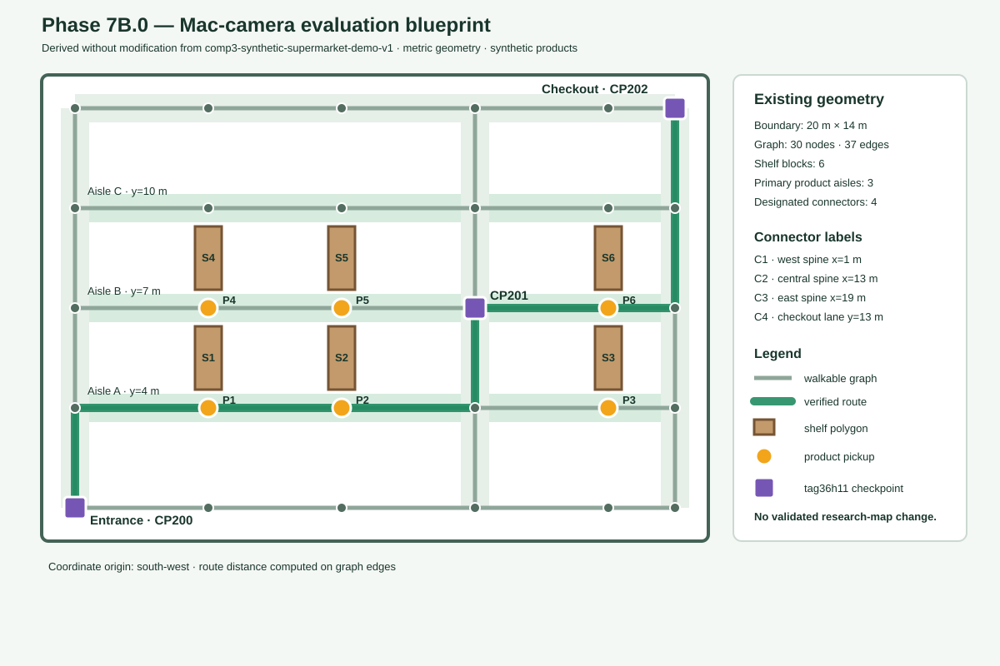

# Phase 7B.0 — Simulation Verification and Mac-Camera Evaluation Plan

Status: design and feasibility review only. No camera capture or live detector integration is implemented in this phase.

## Scope and baseline

This plan uses the committed `comp3-synthetic-supermarket-demo-v1` layout and preserves the validated research files `data/store_map/store_graph.json` and `data/store_map/apriltag_layout.json`. The evaluation contains no IoT trolley, encoder, IMU, motor controller, or other physical navigation hardware. Virtual movement remains inside the deterministic simulator; a later Mac-camera mode would supply only checkpoint observations.

The verified baseline is branch `Comp3_Arun` at commit `4cc31bc7d113088ee2e0234a313889671c485fd3`.

## Existing geometry audit

The versioned demo occupies 20 m × 14 m and derives a connected undirected graph with 30 nodes and 37 edges. Lane width is 0.8 m. Graph rows are at y = 1, 4, 7, 10, and 13 m; columns are at x = 1, 5, 9, 13, 17, and 19 m. Vertical connections already exist at x = 1, 13, and 19 m.

The six shelf polygons are preserved exactly:

| Shelf | Section | Bounds `[left,bottom,right,top]` m | Pickup node | Levels |
|---|---|---|---|---:|
| DEMO-SHELF-01 | Produce | `[4.6,4.55,5.4,6.45]` | N1_1 | 4 |
| DEMO-SHELF-02 | Bakery | `[8.6,4.55,9.4,6.45]` | N1_2 | 4 |
| DEMO-SHELF-03 | Dairy | `[16.6,4.55,17.4,6.45]` | N1_4 | 4 |
| DEMO-SHELF-04 | Pantry | `[4.6,7.55,5.4,9.45]` | N2_1 | 4 |
| DEMO-SHELF-05 | Cereal | `[8.6,7.55,9.4,9.45]` | N2_2 | 4 |
| DEMO-SHELF-06 | Frozen | `[16.6,7.55,17.4,9.45]` | N2_4 | 4 |

For the physical tabletop/floor blueprint, the three primary customer aisles are the existing y = 4, 7, and 10 m corridors. Four existing graph corridors are designated as connecting lanes: west x = 1 m, central x = 13 m, east x = 19 m, and checkout/rear y = 13 m. The y = 1 m row remains the entrance lane. This is a naming/designation layer only; the full five-row/three-spine graph remains visible and unchanged.

Every pickup and all three demo checkpoints are graph nodes in the entrance-connected component, so they are reachable. The demo-store validator additionally rejects shelf intersections, inaccessible pickups, nonadjacent shelf-facing points, invalid checkpoint nodes, and disconnected layouts.

## Proposed 2D evaluation blueprint

The blueprint is rendered directly from the existing metric coordinates. It shows:

- six shelf blocks S1–S6;
- three highlighted product aisles;
- four designated connecting lanes, plus every other existing walkable edge;
- entrance N0_0 / CP200 and checkout N4_5 / CP202;
- all 30 graph nodes and 37 graph edges;
- pickup points P1–P6;
- checkpoints CP200, CP201, and CP202; and
- the verified Bananas → Frozen peas → checkout route.

No map extension is required. If a later physical setup requires exactly four vertical cross-aisles rather than four designated connector corridors, that would not be a documentation-only change: the available x = 5, 9, and 17 m columns intersect shelf blocks. The smallest safe extension would therefore require a new demo-map version and independently validated shelf/aisle geometry; it must not alter the research map or silently mutate demo v1.

## AprilTag card plan

The demo layout constructs an `AprilTagLayout` with OpenCV dictionary/family `tag36h11`. It is intentionally separate from the research layout IDs 100–115.

| Card | Demo node | Evaluation role | Expected behavior |
|---|---|---|---|
| tag36h11 ID 200 | N0_0 | Entrance/start checkpoint | Accepted first; initializes/confirms entrance localization |
| tag36h11 ID 201 | N2_3 | Central cross-aisle | Accepted only when it is the next expected checkpoint |
| tag36h11 ID 202 | N4_5 | Checkout | Accepted only after route order reaches checkout |
| tag36h11 ID 42 | none | Known-family but unmapped negative case | Rejected as `unknown_tag`; no correction |
| tag36h11 ID 202 shown before 201 | N4_5 | Out-of-order case | Rejected as `unexpected_checkpoint`; no correction |

The configured marker edge length is 0.16 m. The proposed print card is 200 mm × 200 mm with a 160 mm marker square centered on the card and an unprinted 20 mm white margin on every side. Printing must be at 100% scale with no “fit to page,” cropping, interpolation, or family conversion. Before evaluation, measure the black marker edge with a ruler and record the actual dimension. Matte card stock or a rigid matte backing is preferred to reduce glare and curvature.

Duplicate reads of an already accepted ID must return `duplicate_observation` and must not add a second correction. A known but premature ID must return `unexpected_checkpoint`. An observation with the wrong map ID, a nonfinite/negative timestamp, low confidence, inconsistent observed position, or a correction greater than 2.0 m must be rejected without changing the estimator or confirmed checkpoint.

The supported detector is the existing OpenCV ArUco interface using `cv2.aruco.ArucoDetector` and `cv2.aruco.DICT_APRILTAG_36h11`. The verified local environment is CPython 3.14, `opencv-contrib-python==5.0.0.93`, OpenCV 5.0.0, and `numpy==2.5.4`. Do not install a second `opencv-python` package alongside the contrib build.

## macOS camera feasibility and setup

A built-in Mac camera is feasible for card-ID observation because OpenCV exposes a local `VideoCapture` interface and the installed contrib build already contains the required dictionary/detector. Feasibility does not establish detection reliability; lighting, focus, viewing angle, motion blur, display/print quality, and camera distance must be measured in the later evaluation.

Before a later camera run:

1. Use `component3/.venv/bin/python`; do not modify system Python.
2. Open **System Settings → Privacy & Security → Camera** and permit the actual launcher application—Terminal, iTerm, or the selected IDE. macOS may show the permission prompt on first capture.
3. Close FaceTime, Photo Booth, Zoom, Teams, and other camera consumers.
4. Begin with camera index 0; enumerate or manually review alternatives rather than silently selecting an arbitrary device.
5. Keep capture local and show a visible preview/stop control. Do not transmit frames or add cloud APIs.
6. Record camera name/index, resolution, frame rate, lighting, marker distance, angle, and actual printed marker size with each run.

Only the existing pinned NumPy and `opencv-contrib-python` dependencies are expected for a minimal Python/OpenCV prototype. No browser camera API, cloud service, or IoT dependency is required. A future implementation may need to refactor the existing file-path detector so its tested array-based core can accept grayscale camera frames while preserving the offline file wrapper.

## Evaluation mode A — automatic synthetic navigation

1. Start the local server with `python3 -B -m component3.simulations.navigation_dashboard.dashboard`.
2. Expect a terminal log similar to `Serving dashboard at http://127.0.0.1:8765`.
3. Open the root dashboard, select two or more `SIM-P-*` items, calculate the route, and start navigation—or use **Start Guided Demo** for the deterministic scenario.
4. The server advances virtual movement from seeded synthetic wheel/IMU samples.
5. Synthetic checkpoint observations are explicitly labeled `synthetic_spatial_simulator`; accepted events update the checkpoint symbol and correction telemetry.
6. Product arrival displays the configured side, shelf, section, and level. Manual mode waits for **Confirm simulated pickup**; guided mode records `guided_demo_automated_simulated`.
7. A wrong turn must first satisfy the existing deviation confirmation policy. The existing route manager then preserves remaining products and checkout.
8. Completion requires every selected product confirmation before N4_5/CP202.

Expected UI/event messages include `Approaching checkpoint CP201`, `Checkpoint CP201 confirmed; localization updated`, `Wrong turn confirmed. Recalculating the remaining route`, `Rerouting complete. Follow the updated highlighted route`, product-specific shelf text, and `Checkout reached after all selected products were confirmed`.

## Evaluation mode B — proposed Mac-camera-assisted checkpoints

Virtual movement, route calculation, arrival, pickup confirmation, deviation detection, and rerouting remain unchanged. The difference is that automatic synthetic checkpoint submission is disabled for this mode and a local camera worker supplies observations:

1. Start the simulator in an explicit camera-assisted evaluation mode.
2. Display the expected next checkpoint in the terminal and dashboard, for example `Waiting for tag36h11 ID 201 at N2_3`.
3. Open the approved Mac camera and display a local preview with **Scan/Accept** and **Stop** controls. Continuous detection may propose a candidate, but one stable candidate policy should prevent frame-by-frame duplicates.
4. Convert an actual detector result into `CheckpointObservation(tag_id, timestamp_s, detection_source="mac_builtin_camera", map_id, confidence/quality where available)`.
5. Submit it through the existing observation processor. The camera adapter must not directly edit pose, confirmed IDs, or route state.
6. On acceptance, expect `Accepted CP201; correction X.XXX m`; update the blueprint checkpoint state and estimated-position marker from the accepted correction.
7. On rejection, expect a reason such as `unknown_tag`, `unexpected_checkpoint`, `duplicate_observation`, `wrong_map_version`, `confidence_below_threshold`, or `correction_exceeds_limit`. Keep the old estimated pose and confirmed checkpoint visibly unchanged.
8. Continue virtual movement only according to a documented policy: either pause at a checkpoint gate until the expected card is accepted, or allow movement while marking localization pending. The gate policy is recommended for the first controlled evaluation.
9. Product pickup remains manual. Camera checkpoint detection must never imply product recognition or collection.
10. Permit checkout only after all products are confirmed and CP202 is accepted according to route order.

## Metrics and records

Mode A should retain deterministic completion rate, product order, checkpoint order, guidance-event order, wrong-turn/deviation/reroute counts, arrival decisions, position error against synthetic truth, and repeatability across seeds/runs.

Mode B should record, with explicit denominators:

- expected-card detection rate and missed-card count;
- accepted/rejected decision accuracy for correct, unknown, premature, duplicate, wrong-map, and implausible-correction cases;
- false accepts per presented negative card and per processed frame;
- time and processed frames from card presentation to stable detection;
- duplicate proposals versus duplicate corrections applied (target: zero duplicate corrections);
- correction magnitude and whether it passed the 2.0 m guard;
- checkpoint-order completion rate;
- manual pickup-confirmation count and duplicate-confirmation attempts;
- end-to-end checkout completion rate; and
- camera configuration, resolution, approximate distance, angle, and lighting notes.

Camera-frame truth must be independently labeled from the detector output. Physical-camera results must not be mixed with synthetic truth metrics or described as trolley localization accuracy.

## Smallest later implementation plan

1. Add a tested array/frame detector core beneath the existing file detector without changing tag family.
2. Add a small local camera adapter that owns `VideoCapture`, permission/error reporting, preview lifecycle, and deterministic shutdown.
3. Add an explicit simulation configuration that chooses `synthetic` or `mac_camera` checkpoint source; never mix both silently.
4. Reuse `CheckpointObservationProcessor` and `/api/spatial/control` `observe_checkpoint`; do not create a second correction path.
5. Add checkpoint-gate state and clear terminal/dashboard status for waiting, candidate, accepted, and rejected observations.
6. Add unit tests with mocked frames/capture and integration tests with recorded local fixtures before any live session.
7. Run a separately labeled physical-camera evaluation and create new evidence IDs only after genuine captures exist.

## Risks and limitations

- Built-in-camera focus, field of view, glare, print scaling, and motion blur may prevent reliable detection.
- A single camera image and known tag ID can correct to a configured checkpoint but does not by itself estimate general trolley pose or prove physical localization accuracy.
- OpenCV detection confidence is not inherently equivalent to calibrated probability; a defensible quality measure must be defined before using the confidence gate.
- Camera permission behavior depends on the launcher application and macOS privacy state.
- The map, products, route motion, and shelf levels remain synthetic. There is no IoT hardware or surveyed supermarket.
- Endpoint-anchored reroute cost still omits partial-edge travel.
- The proposed card size and operating distance require empirical verification; they are an evaluation starting point, not a validated specification.
